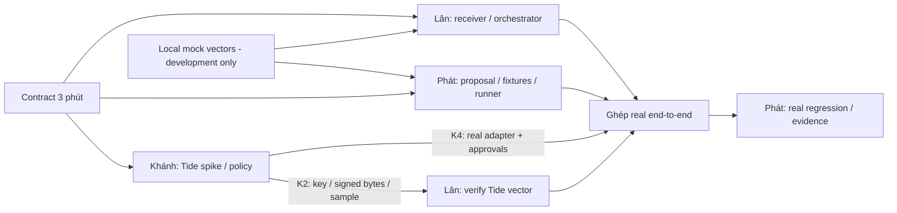

# PLAN — Ba luồng kỹ thuật song song cho Leash

> **Cập nhật vai trò:** đồng đội phụ trách implementation; Lân phụ trách final QA trước nộp theo [FINAL_QA_TESTCASES.md](docs/FINAL_QA_TESTCASES.md) và [results sheet](docs/FINAL_QA_RESULTS.csv). Phân công implementation bên dưới là kế hoạch lịch sử, không còn là task mặc định của Lân.

## 1. Mục tiêu và timebox

**Đội:** Khánh — SE; Phát — AI; Lân — SE.

**Mục tiêu sprint:** invoice → proposal → Tide authorization/signing → receiver độc lập, với một allowed case và các denied cases có evidence. Tập trung implementation, integration và tests. Video, pitch, form và đóng gói submission được xử lý ở checklist riêng sau sprint; chưa phân công thời gian cho chúng trong kế hoạch này.

**Timebox tham chiếu:** 45 phút theo yêu cầu trước. `t=0` là lúc nhóm bắt đầu áp dụng kế hoạch, không có nghĩa vẫn còn nguyên 45 phút trước deadline thực. Nếu thời gian ít hơn, cắt optional work và giữ checkpoint tích hợp cuối. Lân xác nhận riêng thời gian/rules với BTC; việc này không là dependency của local development.

Repo hiện mock-only. Real Tide integration chưa được chứng minh; không bảo đảm có thể hoàn thành từ đầu trong timebox. Cho phép dùng mock để phát triển các phần độc lập, nhưng chỉ real-path evidence mới chứng minh Tide enforcement.

## 2. Cách chia để ít block nhau

| Luồng | Owner | Làm được ngay, không đợi ai | Dependency bắt buộc khi tích hợp thật |
|---|---|---|---|
| **Authority / Tide** | Khánh | Kiểm tra realm/license/SDK, chạy official sample, deploy policy, approvals flow | Payload contract đã chốt; actual Tide access |
| **Proposal / attack fixtures** | Phát | Parser/proposal validation, valid/hostile cases, test vectors, reusable scenario runner | Adapter/verifier thật để chạy real-path scenarios |
| **Receiver / orchestration** | Lân | Verifier process riêng, trusted config, tamper/replay checks, runner với mock adapter | Signing scheme/bytes/key provenance và signature thật từ Khánh |

**Nguyên tắc:** chốt interface nhỏ trước; dùng fixtures hoặc mock rõ nhãn để làm tiếp; trao artifacts thay vì chờ người khác hoàn thành toàn bộ module. Không dồn cả ba vào Tide setup. Khi Khánh bị blocker, Phát và Lân tiếp tục phần độc lập của mình.

## 3. Interface cần chốt trong 3 phút đầu

Đây là interface nội bộ đề xuất cho Leash, không phải API của Tide. Giữ signature hiện có khi dùng được; chỉ thêm wrapper nếu cần.

| Boundary | Input/output cần thống nhất | Owner quyết định |
|---|---|---|
| Proposer → payment builder | `invoiceId, amountMinor, currency, payeeId, payeeAccount`; proposal luôn untrusted | Phát + Lân |
| Payment → signer | Theo exact fields trong `docs/SIGNATURE_PROTOCOL.md`; nonce/domain/version/expiry do builder tạo, không lấy tự do từ model | Lân; Khánh review |
| Signer adapter | Giữ `signIfAllowed(payment, context)` nếu phù hợp; success/deny/dependency-error phải phân biệt; output có mode và signature artifact đủ cho verifier | Khánh + Lân |
| Approval context | Mock IDs chỉ cho local tests; real approvals dùng proof và request binding theo SDK đã kiểm chứng | Khánh |
| Signer → verifier | Exact signed bytes/scope, scheme, signature encoding và trusted key/context; nếu là envelope/hash phải chứng minh binding tới payment | Khánh cung cấp, Lân verify |
| Trusted config | Key/policy trust anchor provision ngoài payment request; backend request không tự chọn key hoặc policy yếu hơn | Lân + Khánh |
| Test runner | Cùng fixtures chạy được với mock hoặc real adapter, kết quả luôn có mode/test ID/observed outcome | Phát |

**Lưu ý:** phần Tide chưa biết được ghi `UNKNOWN`, không đoán protocol để khóa interface sai. Lân phát triển verifier với local test vectors trước; Khánh gửi scheme/bytes thực ngay khi biết để chỉnh đúng một boundary.

## 4. Task kỹ thuật cụ thể và tiêu chí Done

### Khánh — SE: Tide authority

| ID | Task / thứ tự | Dependency | Deliverable và Done |
|---|---|---|---|
| K1 — P0 | Kiểm tra realm/license/identity/session; chạy official signing example | Chỉ actual Tide access | Runtime output hoặc lỗi cụ thể; SDK version và runnable command, không chỉ link docs |
| K2 — P0 | Xác định signed bytes/scheme/key provenance; đưa một signature sample cho Lân | K1 | Bộ vector synthetic gồm request, signature, public key/fingerprint và scope; không tokens/private keys |
| K3 — P0 | Adapt/compile/deploy policy; kiểm tra exact payload và approvals thật | Payload contract + K1 | Valid payment được ký, forbidden payee/thiếu approvals bị Tide deny; không chỉ local guard |
| K4 — P0 | Nối real adapter, fail closed, expose error states | K2/K3 | `tideForsetiSigner.mjs` gọi SDK thật; không mock fallback; command real chạy lại được |
| K5 — P1, bắt buộc cho claim governance | Kiểm tra QEA, actual threshold, policy/registry/key substitution và master limitation | K3/K4 | T6/T8 evidence hoặc limitation rõ; không claim non-unilateral rộng hơn proof |

K2 nên bàn giao ngay, không đợi K3/K4 hoàn tất. Nếu signer/key sample chưa gắn policy thì đánh dấu rõ: chỉ phục vụ verifier compatibility, chưa phải G4 PASS.

### Phát — AI: proposal và adversarial scenarios

| ID | Task / thứ tự | Dependency | Deliverable và Done |
|---|---|---|---|
| P1 — P0 | Chạy baseline; kiểm tra proposal fields, integer cents và invalid invoice | Không | Unit/fixture results có output; lỗi cụ thể nếu fail |
| P2 — P0 | Freeze valid-high, hostile payee, missing approval, tampered payment inputs | Payload contract; dùng mock trước | Fixtures reproducible; expected outcomes; không credentials thật |
| P3 — P0 | Viết/reuse scenario runner nhận adapter và verifier; T1–T5, bổ sung T7 phù hợp | Chỉ interface; mock đủ để phát triển | Chạy local, test IDs/mode rõ; không hardcode mock signer vào real runner |
| P4 — P0 | Chạy cùng scenarios trên real adapter, ghi evidence | K4 + verifier của Lân | Observed real accept/deny; chỗ chưa chạy ghi BLOCKED, không lấy local PASS thay |
| P5 — Optional | Real LLM extraction, structured-output validation | Chỉ sau G4 và cả nhóm đồng ý/provider được phép | Model output vẫn untrusted; model lỗi không vượt authority |

Không cần LLM để kiểm tra boundary. Khi chưa có Tide, Phát tiếp tục negative fixtures, regression và test harness; không ngồi đợi và không bắt đầu training/OCR/API tốn phí.

### Lân — SE: independent receiver và integration

| ID | Task / thứ tự | Dependency | Deliverable và Done |
|---|---|---|---|
| L1 — P0 | Freeze canonical payload/TTL; xác định trusted config, sửa expiry quá xa cho runtime | Contract 3 phút đầu | Test vectors cố định, finite TTL; signer/verifier cùng scope |
| L2 — P0 | Tách receiver executable/process; verify và key pinning, tamper/domain/expiry checks | Mock vectors đủ để bắt đầu | Unsigned/wrong-key/modified payload fail; receiver không nhận key tùy ý từ request |
| L3 — P0 | Replay state có persistence nhỏ; unique nonce và record atomically | L2; không cần Tide | Replay fail sau restart; kiểm tra concurrency nếu claim hỗ trợ; cùng invoice nonce mới là case riêng |
| L4 — P0 | Orchestrator CLI tối thiểu: fixture → proposal → signer → receiver | Mock adapter + P1/P2 đủ để làm trước | Allowed/denied mock chạy rõ mode; đổi sang real adapter không bypass policy |
| L5 — P0 | Verify vector thật; ghép real path, clean rerun | K2 rồi K4 + P3 | Actual Tide signature verify độc lập; T1–T5 có kết quả; secrets không lộ |

Ưu tiên CLI chạy được trước UI. Không refactor frontend hoặc đổi framework. Chọn persistence nhỏ theo runtime sẵn có; nếu chưa kiểm chứng atomic/restart thì ghi giới hạn, không gọi durable replay protection.

## 5. Ownership để tránh conflict

| Người | File/area chính |
|---|---|
| Khánh | `src/signing/tideForsetiSigner.mjs`, contract thực trong `forseti/`, Tide SDK/config đã redact |
| Phát | `src/agent.mjs`, `src/parser.mjs`, `fixtures/`, `model/schema/`, scenario runner và tests mới riêng |
| Lân | `src/bank.mjs`, `src/canonical.mjs`, receiver/orchestrator entry points, config/nonce persistence |

Phát sở hữu sửa CLI entry-point issue của `src/securityScenarios.mjs`; Lân sở hữu `src/demo.mjs`. Cùng thêm `package.json` scripts thì nhờ Lân gộp một lần, không sửa đồng thời. Thay fixture/schema/payload phải báo người tiêu thụ và chạy lại tests.

## 6. Lịch kỹ thuật tham chiếu 45 phút

| Elapsed | Khánh | Phát | Lân | Handoff/checkpoint |
|---|---|---|---|---|
| **0–3 phút** | Chốt adapter boundary, kiểm tra access | Chốt proposal/fixture contract | Chốt payload/verifier boundary | Ba interface thống nhất; mỗi người bắt đầu riêng |
| **3–12 phút** | K1, gửi K2 ngay khi có | P1/P2, mock tests | L1/L2, verifier local vectors | Không ai đợi real integration để làm module |
| **12–20 phút** | K3/K4; policy + approvals | P3 runner mock; negative cases | L3/L4; receiver/orchestrator mock | t=20: có real progress hay blocker cụ thể |
| **20–30 phút** | Hoàn thiện real sign/deny; K5 nếu sẵn | P4 khi real sẵn; nếu chưa thì regression | Verify K2 sample, ghép K4 ngay khi sẵn | Tích hợp từng artifact, không chờ cuối sprint |
| **30–38 phút** | Sửa authority P0, T6/T8 | Real T1–T5/T7; redacted logs | Sửa verifier/orchestration/replay P0 | Một allowed và denied flow xuyên suốt |
| **38–45 phút** | Review key/policy/approval proof | Rerun và tổng hợp test results | Clean rerun, setup command, đồng bộ status | Technical handoff; freeze feature mới |

10 phút cuối dành cho integration/regression, không quay video hoặc nộp form trong sprint này. Requirements submission vẫn theo checklist riêng; hoàn thành technical sprint không đồng nghĩa đã nộp hợp lệ.

## 7. Dependency graph

Real end-to-end là dependency không thể loại bỏ. Giảm block bằng bàn giao K2 sớm, reusable adapter boundary và fixtures cố định; không giảm bằng giả Tide signature hoặc fake human approvals.

## 8. Blocker và checkpoint

- **Thiếu realm/license/network:** Khánh báo lỗi, command và nhu cầu cụ thể; Phát/Lân vẫn hoàn tất module local. Chỉ nhờ Lân hỗ trợ spike nếu cần thao tác xác định, không bỏ cả receiver stream.
- **t=12 chưa có runtime progress:** không bắt đầu UI/LLM. Khánh timebox spike tiếp tới t=20, hai luồng khác giữ tiến độ độc lập.
- **t=20 chưa có real signing path khả thi:** ghi BLOCKED G3/G4; nhóm quyết định tiếp tục spike có hướng sửa cụ thể hoặc handoff mock rõ nhãn. Không coi còn đủ thời gian chắc chắn hoàn thành.
- **Signing được nhưng chưa policy/approvals:** tiếp tục compatibility tests, G4 vẫn chưa PASS.
- **G1 xác nhận đóng, không extension:** không tiếp tục với giả định sẽ nộp được; local work chỉ là practice/handoff nếu nhóm muốn.
- Pivot sang use case khác chỉ khi nhóm quyết định và capability mới được kiểm chứng, không tự gọi login-only là đủ challenge.

## 9. Tests và evidence tối thiểu

| Case | Expected | Responsible |
|---|---|---|
| Valid + đủ approvals thật | Tide ký, verifier riêng accept | Khánh + Lân |
| T1 — hostile payee tới Tide | Tide policy deny; không chỉ backend chặn | Khánh; Phát chạy |
| T2 — unsigned bypass | Receiver reject | Lân |
| T3 — thiếu/giả/duplicate/self-approval | Authorization fail; ghi trường hợp chưa hỗ trợ/test | Khánh; Phát chạy |
| T4 — sửa amount/account sau ký | Bad signature | Lân; Phát regression |
| T5 — replay | Reject; ghi rõ same process/restart/concurrency | Lân |
| T6 — admin tự đổi quyền/policy | Không solo override trong scope đã chứng minh | Khánh |
| T7 — expiry/domain/key/currency | Reject đúng tầng | Phát + Lân |
| T8 — policy/key substitution | Không đổi trust anchor bằng request | Khánh + Lân |

Evidence: test ID, mode, command, UTC time, commit, SDK/contract version/hash, payload hash, observed result, verifier output, reviewer và limitations. Không tokens/dokens/private keys. Signature đúng chưa tự chứng minh approvals hoặc policy đúng.

Baseline commands: `npm run preflight`, `npm test`, `npm run validate:fixtures`, `npm run security`. Windows có thể cần `npm.cmd`; xem README để gọi exported functions khi CLI entry-point chưa sửa. `test:tide` hiện chỉ probe fail closed, cần real tests trước khi gọi PASS. Không coi exit 0 không output là đã chạy tests.

## 10. Technical handoff và gate status

- [ ] Proposal/fixtures deterministic, schema hợp lệ, model output luôn untrusted.
- [ ] Real Tide policy thấy đúng payload; valid ký và forbidden deny; approvals thật.
- [ ] Verifier process riêng pin đúng key/context, không tin key/policy từ request.
- [ ] T1–T5 real path PASS; T6–T8 có evidence hoặc giới hạn rõ.
- [ ] Replay/persistence claim khớp test thực; finite expiry/domain/version được verify.
- [ ] Không mock fallback, secrets hoặc dữ liệu thật; modes rõ trong output.
- [ ] Clean rerun từ command được ghi, prerequisites và blockers rõ.
- [ ] `STATUS.json`, `PROJECT_STATUS.md`, claims, decision log và backlog khớp evidence khi milestone hoàn thành.

Giữ gate IDs của repo: **G1 rules**, **G2 local baseline**, **G3 Tide environment**, **G4 real policy/signing/independent verification**, **G5 real security tests**, **G6 submission**. G6 nằm ngoài technical sprint này, vẫn pending cho tới khi toàn bộ submission requirements hoàn thành. Theo dõi riêng ở [submission checklist](docs/SUBMISSION_CHECKLIST.md) và [challenge checklist](docs/CHALLENGE_CHECKLIST.md).

Mỗi checkpoint chỉ báo: **artifact đã sẵn sàng → command/evidence → blocker → ai cần gì**. Chỉ cập nhật PASS khi đã chạy đúng đường thực tế; không thay đổi implementation scope để che requirement chưa đạt.

