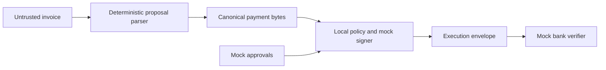

# Leash — AI Payment Authorization

## Project overview

Leash is a security prototype for AI-assisted invoice payments that separates payment proposals from authorization to execute them.

### 1. Vision & originality (25%)

An AI assistant prepares payments; a separate authorization boundary decides whether they may execute. Leash combines payment-specific approvals, policy-gated signing and verification of the exact payment bytes.

### 2. Trust constraint insight (20%)

An invoice can manipulate an AI into proposing an attacker’s account. The intended Tide integration would prevent that proposal—or a compromised application backend—from becoming payment authority without independently enforced authorization.

### 3. Value & impact (20%)

Finance teams could automate invoice preparation while retaining approval control. For example, a synthetic $1,500 supplier payment requires two distinct approvers; redirecting it to an account outside the vendor allowlist is denied.

### 4. Why TideCloak matters (20%)

The planned integration uses TideCloak identities, Forseti policy checks and ORK distributed signing to move authorization outside the application backend. Today these protections are simulated; live Tide authorization and signing remain unverified.

### 5. Prototype & storytelling (15%)

Follow an approved payment, a hostile payee substitution, and receiver rejection of tampered or replayed payments. The working prototype uses synthetic invoices, a deterministic parser, mock approvals, local signing and a simulated bank. No funds move.

## Run the demo

**Current mode: local simulation (`MOCK_ONLY_NOT_TIDE`).** The official [Plan C](https://tide.org/unlocked/#plan-c) permits simulated protections and equal judging with live integrations.

Requires **Node.js 20+ and npm**; no dependency installation, Docker, Tide realm or API credentials. From the repository root:

```sh
npm run preflight
npm test
npm run server
```

Open **[http://127.0.0.1:8787](http://127.0.0.1:8787)** and select **Full Lifecycle**. Sign-in is unnecessary for this simulation; the experimental TideCloak login panel depends on a separately configured local realm.

| Demo case | Expected JSON result |
|---|---|
| $550 payment with one mock approval | `legitLowValue.execution.code: EXECUTED` |
| $1,500 payment with two mock approvals | `legitHighValue.execution.code: EXECUTED` |
| Hostile invoice redirects the payee | `maliciousSigning.detail: UNTRUSTED_PAYEE` |
| Unsigned request / modified signed amount | `MISSING_SIGNATURE` / `BAD_SIGNATURE` |
| Reused nonce / substituted key ID | `REPLAY_NONCE` / `UNTRUSTED_KEY_ID` |

Select **T1–T18 Suite** for the local security scenarios. The lifecycle receiver resets each run; the HTTP pipeline persists nonces.

Use `npm.cmd` in PowerShell if needed. Preflight’s historical gate reminders do not determine current submission eligibility.

## Architecture and Tide integration



All components above run within the local application. The mock signer uses Ed25519 with an application-accessible private key. The receiver checks the configured public key, signed bytes, envelope context, expiry and nonce reuse; it simulates bank acceptance.

The [local protocol](docs/SIGNATURE_PROTOCOL.md) binds nine payment fields, including amount, payee, nonce, domain and expiry. Amounts use integer cents. Mock policy accepts allowlisted USD payees and requires one approver below **$1,000**, two distinct approvers at or above it. Duplicate and self-approvals are rejected; default validity is 15 minutes.

| Boundary | Implemented locally | Intended Tide integration |
|---|---|---|
| Identity and consent | Demo approver IDs; optional payment-bound HMAC proofs | Authenticated TideCloak identities and independently verified payment approvals |
| Policy and signing | Application policy and local Ed25519 signature | Deployed Forseti policy gating distributed ORK signing |
| Receiver verification | In-process mock verifier with configured trust anchor | Separate receiver validating the actual Tide signature and trusted key |

The [real adapter](src/signing/tideForsetiSigner.mjs) is unverified scaffolding: without configuration it fails with `REAL_TIDE_NOT_WIRED`. The [Forseti contract candidate](forseti/LeashPaymentPolicy.cs) has no compilation or deployment proof. See the [integration guide](docs/REAL_TIDE_INTEGRATION.md) for the remaining work.

## Verification and limitations

Verified locally on **22 October 2026**, using **Node.js 22.18.0**: **35 unit tests, seven fixtures, 18 mock security scenarios and 20 offline QA checks passed**. These results cover local behavior; live Tide enforcement and release readiness require separate evidence.

```sh
npm run validate:fixtures
npm run validate:contracts
npm run qa:final
```

`validate:contracts` checks schema and protocol consistency, not C# compilation. `qa:final` creates ignored local evidence without updating the canonical results sheet; see the [QA guide](docs/FINAL_QA_AUTOMATION.md) and [test cases](docs/FINAL_QA_TESTCASES.md).

- **Authentication is incomplete.** The login experiment decodes JWT claims without verifying signatures; the payment API has no enforced authentication boundary. Mock proof enforcement is optional, and the application can issue demo approvals.
- **Backend compromise resistance is a design goal.** Local keys, policy and approval credentials remain accessible to application code. Live human consent, Tide signing and governance protections have not been demonstrated.
- **Replay checks have demo scope.** The pipeline persists nonces in a temporary-directory ledger, configurable with `LEASH_BANK_STORAGE_PATH`. Mock keys regenerate on restart; production key lifecycle and crash durability are unverified. Duplicate-invoice blocking is optional and disabled in the default HTTP receiver.

Leash limits authority after a bad AI proposal; it does not reliably classify fraudulent invoices.

## Further reading

- [Threat model](docs/THREAT_MODEL.md) and [security claim ledger](docs/SECURITY_CLAIMS.md)
- [Demo storyboard](docs/DEMO_STORYBOARD.md) and [submission checklist](docs/SUBMISSION_CHECKLIST.md)
- [Official challenge requirements](research/official-rules.md) and [project status](STATUS.json)
