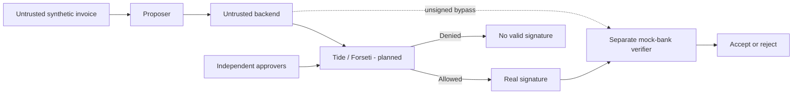

# Leash — Authorization Boundary for AI Payment Agents

> AI chuẩn bị giao dịch; quyền thanh toán được kiểm tra độc lập trước khi ký.

Leash là cybersecurity proof of concept cho quy trình xử lý hóa đơn có AI hỗ trợ. AI/proposer được tạo đề xuất thanh toán, nhưng AI và backend không giữ khóa ký hoặc tự quyết định vượt policy. TideCloak/Forseti dự kiến thực thi policy và xác thực approvals trước khi ký; mock bank xác minh bằng chứng trước khi chấp nhận giao dịch.

**Trạng thái hiện tại: MOCK ONLY — repo mới setup.** Real Tide signer chưa triển khai; chưa tích hợp LLM thật. Các phần ghi “dự kiến” là mục tiêu thiết kế. Chỉ dùng dữ liệu synthetic, không chuyển tiền thật.

> **Trước khi nộp:** thay phần giới thiệu đầu README bằng overview theo đúng năm prompts chính thức của BTC và word limit được xác minh. Theo brief hiện có, overview ≤300 words; mô tả chi tiết và setup đặt bên dưới. Repo chưa có wording chính thức. README này chưa phải submission overview hoàn chỉnh.

## Bài toán và giá trị

Doanh nghiệp muốn AI giúp chuẩn bị thanh toán, nhưng hóa đơn có thể chứa chỉ dẫn độc hại khiến AI đổi tài khoản nhận tiền. Backend cũng có thể bị xâm nhập. Nếu backend vừa kiểm tra policy vừa giữ khóa ký, attacker kiểm soát backend có thể vượt qua kiểm tra của ứng dụng.

**Leash muốn cho phép sử dụng AI mà không giao cho AI/backend toàn quyền thanh toán.** Hệ thống tách ba trách nhiệm:

1. **Propose:** tạo payment proposal từ hóa đơn không đáng tin.
2. **Authorize:** Tide/Forseti dự kiến kiểm tra đúng nội dung cần ký và approval proofs độc lập.
3. **Verify:** receiver kiểm tra chữ ký, nội dung, expiry và replay trước khi chấp nhận.

Leash giới hạn hậu quả của proposal sai; không phải sản phẩm phát hiện mọi hóa đơn gian lận.

| Actor | Trách nhiệm | Không mặc nhiên có quyền |
|---|---|---|
| AI/proposer | Đọc invoice, tạo proposal | Ký thanh toán hoặc giả approval |
| Backend/operator | Chuyển request, vận hành app | Giữ signing key; tự thay policy |
| Finance approvers | Phê duyệt đúng request | Vượt policy đã được bảo vệ |
| Tide/Forseti | Dự kiến kiểm tra policy và ký | Không được thay bằng mock rồi gọi là Tide thật |
| Mock bank | Verify và ghi nhận demo payment | Tin `approved=true` hoặc key do request tự gửi |

## Demo dự kiến

| Tình huống | Kết quả cần chứng minh |
|---|---|
| Valid payment, đủ approvals thật | Tide ký; independent verifier chấp nhận |
| Proposer đổi payee sang ngoài allowlist | Request tới Tide bị từ chối ký |
| Thiếu/giả/self-approval | Không có authorization hợp lệ |
| Backend gọi bank không có signature | Receiver từ chối |
| Sửa amount/account sau ký | Verification thất bại |
| Gửi lại cùng signed payment | Replay bị từ chối trong phạm vi persistence đã kiểm chứng |

Marker tấn công hiện tại chỉ mô phỏng proposer nghe theo tài liệu độc hại, chưa chứng minh một LLM thật bị prompt injection.

## Vì sao Tide là phần cốt lõi?

Quyền ký phải nằm ngoài backend. Login bằng Tide rồi kiểm tra policy bằng JavaScript và ký bằng local key chưa đạt mục tiêu này.

- Tide identity/session dự kiến xác thực executor và approvers theo API thực.
- Forseti dự kiến kiểm tra payload/authorization trước distributed signing.
- QEA quản trị các thay đổi nhạy cảm; cần kiểm chứng protected scope thực tế.
- Receiver pin đúng signing key/context; không tự mặc định đó là JWT public key.

QEA cho thay đổi quản trị khác với approvals từng payment. Có nhiều admin chưa đủ chứng minh một người không thể override: phải kiểm tra threshold và giới hạn `master` realm trong môi trường thực.

## Kiến trúc



Mock hiện tại đặt policy, local signer và bank class trong cùng demo process. Chưa có authority tách khỏi backend hoặc verifier process độc lập.

## Policy và dữ liệu

| Thuộc tính | Quyết định thiết kế, không phải rule BTC |
|---|---|
| Input | Synthetic text invoices trong `fixtures/invoices/` |
| Currency/amount | USD, số nguyên dương theo cents |
| Payee | ID/account khớp trusted registry synthetic |
| Approval | Dưới 100.000 cents: ≥1; từ 100.000 cents: ≥2 người độc lập |
| Self-approval | Không cho executor tự phê duyệt |
| Signed fields | Version/domain/invoice/amount/currency/payee/account/nonce/expiry |
| Receiver | Exact bytes, pinned key/context, expiry/domain, nonce |

Demo chính nên dùng invoice từ 1.000 USD cần hai approvals. Nếu SDK không hỗ trợ flow dự kiến, ghi blocker hoặc thay scope công khai; không thay proof bằng JSON names.

## Tech stack

| Lớp | Hiện có | Dự kiến |
|---|---|---|
| Runtime/backend | Node.js ≥20, ES modules, built-in HTTP | Giữ stack |
| Frontend | HTML/CSS/JavaScript | Một màn hình demo; không đổi framework |
| Proposer | Regex parser, simulated compromised proposer | LLM optional sau security milestone |
| Authorization | Local JavaScript policy, mock IDs | TideCloak/Forseti và approvals thật |
| Signing | Local Node Ed25519, mock-only | Tide distributed signing |
| Contract | C# intent comments | Contract compile/deploy bằng toolchain Tide |
| Receiver state | In-memory nonce Set | Persistence nếu test restart/concurrency |
| Tests | `node:test`, fixtures, mock attacks | Real-path checks, verifier độc lập |

Không cần training, RAG, vector DB, OCR hoặc cloud deployment cho MVP. SDK versions, toolchain và license phải được kiểm chứng; chưa có production claim.

## Chạy baseline local

Yêu cầu Node.js ≥20 và npm. Baseline dùng built-in libraries, không cần `npm install`. Docker/realm/license/network là prerequisites đường Tide thực; có Docker CLI chưa chứng minh realm hoặc daemon hoạt động.

```bash
node --version
npm run preflight
npm test
npm run validate:fixtures
npm run server
```

Mở <http://127.0.0.1:8787>. Server hiện chỉ có mock demo/status, chưa có approval workflow thật.

| Lệnh | Giới hạn |
|---|---|
| `npm test` | Unit tests mock, không chứng minh Tide |
| `npm run validate:fixtures` | Kiểm tra fixture semantics |
| `npm run security` | T1–T5 mock; xem lưu ý Windows |
| `npm run demo` | Mock CLI; xem lưu ý Windows |
| `npm run test:tide` | Hiện là probe báo `REAL_TIDE_NOT_WIRED`, chưa là suite real |
| `npm run demo:real` | Hiện trỏ cùng probe; chưa có real demo |
| `npm run pack:evidence` | Cần Python 3; kiểm tra/redact trước dùng |

**Windows:** dùng `npm.cmd` nếu execution policy chặn npm. Entry-point check hiện tại có thể khiến `security`/`demo` không in kết quả. Không coi exit 0 là đã chạy scenarios. Có thể gọi exported functions:

```bash
node --input-type=module -e "import {runSecurityScenarios} from './src/securityScenarios.mjs'; console.log(runSecurityScenarios().join('\n'));"
node --input-type=module -e "import {runMockDemo} from './src/demo.mjs'; console.log(JSON.stringify(runMockDemo(),null,2));"
```

## Cấu trúc repo

```text
src/                 Proposer, payload, policy, signer, bank, server
src/signing/         Mock signer và real adapter chưa triển khai
forseti/             Policy intent, chưa phải contract chạy được
fixtures/            Synthetic invoices, vendors, approvals
tests/               Unit/negative tests và security matrix
public/              Local demo UI
docs/                Architecture, threat model, protocol, claims, submission
research/            Rules/Tide/prior-art audit cần đối chiếu
step0/               Readiness, decisions, technical spike
evidence/            Templates/local evidence; chưa là real Tide proof
PLAN.md              Kế hoạch 45 phút cho ba người
STATUS.json          Gate status; chỉ đổi khi có evidence
```

## Giới hạn bảo mật hiện tại

- Mock approval IDs chưa xác thực danh tính/consent gắn với payload.
- Nonce state mất khi tạo bank instance mới; cùng invoice với nonce mới chưa bị ngăn như duplicate payment.
- Default expiry mock tới năm 2030; real flow phải chốt TTL hữu hạn.
- Chưa có proof về policy/key substitution resistance, governance hoặc frontend integrity.
- Không ngăn đủ approvers collude, receiver bị compromise hoặc fraud vẫn đúng policy.
- Không dùng tiền thật, dữ liệu khách hàng hoặc credentials trong fixtures/video/repo.

## Quyết định và blockers cần theo dõi

| ID | Nội dung | Owner | Trạng thái / điều kiện đóng |
|---|---|---|---|
| B1 | BTC còn nhận bài; deadline/timezone/form/eligibility | Lân | UNKNOWN; cần nguồn chính thức/BTC |
| B2 | Exact README prompts, rubric, video rules | Lân | Chưa có wording chính thức |
| B3 | Realm/license/SDK, deployed policy, real sign/deny | Khánh | BLOCKED; cần runtime evidence |
| B4 | Key provenance, exact bytes, policy/key binding | Khánh + Lân | Verifier riêng accept/reject đúng |
| B5 | Independent approvals và governance thực | Khánh; Phát review | Chưa kiểm chứng; JSON IDs không là proof |
| D1 | Khoảng 45 phút kể từ lúc nhóm bắt đầu | Cả nhóm | Timebox nội bộ, không thay deadline BTC |
| D2 | Synthetic data, mock bank, không OCR/training | Phát | Working default |
| D3 | LLM chỉ sau security proof và có quyền dùng provider | Phát | Optional, mặc định deterministic |
| D4 | Real fail closed, không ẩn nhãn mock | Cả nhóm | Bắt buộc |

Ghi quyết định đã chốt vào `docs/DECISION_LOG.md`; đồng bộ `STATUS.json`, `PROJECT_STATUS.md` và backlog khi triển khai milestone. Không đổi gate PASS chỉ vì đã viết tài liệu.

## Đội và kế hoạch

| Thành viên | Trách nhiệm |
|---|---|
| **Khánh — SE** | Tide integration, contract, approvals, signing |
| **Phát — AI** | Proposal/schema, attack fixtures, tests/evidence, video; LLM optional |
| **Lân — SE** | Receiver/integration, rules/QA, README và submission |

Xem [PLAN.md](PLAN.md) cho lịch 45 phút, dependency, checkpoint và Definition of Done. Không bảo đảm integration mới từ đầu hoàn thành trong timebox này.

## Submission, nguồn và đóng góp

Theo brief hiện có: public GitHub repo chứa source, README overview đúng template, video 2 phút `.mp4` dưới 100 MB trong repo, nộp URL qua form. Lân cần xác minh lại trước nộp. Snapshot cũ ghi đóng nhận bài không chứng minh trạng thái hiện tại.

- [Challenge](https://tide.org/unlocked/) · [Tide docs](https://docs.tide.org/)
- [Forseti](https://docs.tide.org/Core-Concepts/forseti-engine) · [QEA](https://docs.tide.org/Core-Concepts/iga-workflow)
- [Challenge checklist](docs/CHALLENGE_CHECKLIST.md) · [Security claims](docs/SECURITY_CLAIMS.md)
- [Architecture](docs/ARCHITECTURE.md) · [Trust boundaries](docs/TRUST_BOUNDARY.md)
- [Policy](docs/POLICY_SPEC.md) · [Signature protocol](docs/SIGNATURE_PROTOCOL.md)

Đọc [AGENTS.md](AGENTS.md), [CONTRIBUTING.md](CONTRIBUTING.md), [LICENSE](LICENSE) và [NOTICE.md](NOTICE.md). Không commit `.env`, tokens, dokens, private keys hoặc dữ liệu thật. Repo license không thay thế quyền sử dụng Tide/provider.
