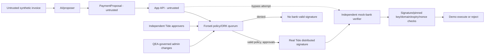

# Architecture — trust is not code location

**In mock:** `src/policy.mjs` and `src/signing/mockSigner.mjs` model these invariants with a local key for test. Mock mode is NOT distributed authority. `src/signing/tideForsetiSigner.mjs` always fails until implemented/verified.

**Never conflate** backend allow/deny with ORK enforcement. Human approval in mock JSON has no authenticity. Real mode must verify human dokens and have policy protect registry/role updates.

**Mock bank:** key is supplied/pinned independently from the signer. Replay set is single-process in demo; production/multi-worker needs transactional persistence. Service cannot claim to be a real bank.
