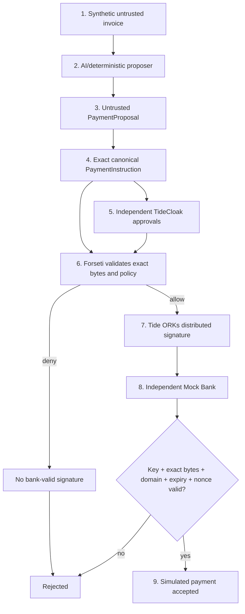

# Leash — Challenge write-up và cơ sở trình bày

**Phiên bản:** 2026-10-22  
**Phạm vi:** Tide UNLOCKED Challenge 2, cybersecurity proof-of-concept  
**Trạng thái hiện tại:** kiến trúc và local mock đã chạy; real TideCloak/Forseti
integration chưa hoàn thành và không được tuyên bố là đã hoàn thành.

> **One-sentence description:** Leash allows an AI agent to prepare payments
> without giving the AI—or its application backend—the cryptographic authority
> to execute them.

> **Nguyên tắc:** AI proposes. Tide authorizes. Mock Bank independently verifies.

---

## 1. Đề bài challenge

Challenge yêu cầu xây dựng một working prototype sử dụng TideCloak để giải
quyết một trust constraint thực tế. Với Leash, trust constraint được chọn là:

> Doanh nghiệp muốn dùng AI để tự động hóa accounts payable, nhưng không thể
> trao cho một mô hình có thể bị prompt injection quyền đơn phương tạo payment
> instruction hợp lệ.

Leash phải chứng minh rằng AI vẫn có thể hỗ trợ xử lý invoice trong khi quyền
authorization và quyền ký được tách khỏi AI và application backend.

### Yêu cầu submission đã xác minh

- Working prototype có tích hợp TideCloak thực tế.
- Public GitHub repository chứa source code, README và video.
- README có one-sentence description và trả lời đúng năm prompt chính thức
  trong tổng cộng không quá 300 từ; setup instructions để riêng.
- Video `.mp4` dài hai phút, nhỏ hơn 100 MB và nằm trong repository.
- Submission thông qua Google Form chính thức.
- Deadline Việt Nam đã công bố: 18:00 ICT ngày 22-10-2026.
- Form yêu cầu team name theo format của RMIT và địa chỉ email thành viên.

Tại lần kiểm tra 06:27 UTC ngày 22-10-2026, form vẫn truy cập được. Eligibility
của team chưa có bằng chứng trong repository, vì vậy gate G1 mới ở mức PARTIAL.
Chi tiết nguồn và hash nằm trong `evidence/challenge-verification.json`.

### Năm tiêu chí trình bày

| Tiêu chí | Trọng số | Leash phải trả lời |
|---|---:|---|
| Vision & originality | 25% | AI được tự động hóa công việc nhưng không được sở hữu payment authority |
| Trust constraint insight | 20% | Prompt injection/compromised backend khiến quyền thanh toán tập trung trở nên nguy hiểm |
| Value & impact | 20% | Finance team giảm thao tác thủ công mà vẫn giữ human and cryptographic control |
| Why TideCloak matters | 20% | Identity, independent approval, policy-gated distributed signing và governance nằm ngoài backend |
| Prototype & storytelling | 15% | Một payment đúng được ký/xác minh; payment độc hại, bypass, tamper và replay bị từ chối |

---

## 2. Problem statement

AI agent đọc invoice và tạo payment proposal. Tuy nhiên invoice là dữ liệu không
đáng tin cậy: người gửi có thể chèn chỉ dẫn để AI đổi payee, account hoặc amount.
Ngoài prompt injection, application backend cũng có thể bị compromise hoặc bị
admin cấu hình sai.

Nếu AI/backend đồng thời có quyền kiểm tra policy và giữ signing key, attacker
chỉ cần compromise cùng trust domain đó để tạo một payment mà receiver vẫn thấy
có chữ ký hợp lệ.

```text
Untrusted invoice
       ↓
AI tạo proposal sai
       ↓
Backend bị bypass/compromise và vẫn có signing key
       ↓
Attacker tạo payment có chữ ký hợp lệ
       ↓
Receiver không biết policy thực sự có chạy hay không
```

Leash không đặt mục tiêu làm AI phát hiện mọi invoice gian lận. Problem cần giải
quyết là **giới hạn authority sau khi AI đã đưa ra một proposal sai**.

### Security objective

> AI agent, application backend hoặc một rogue administrator đơn lẻ không được
> có đủ quyền để tạo ra một payment instruction mà independent receiver chấp
> nhận trái với policy.

### Không thuộc phạm vi

- Không chuyển tiền thật hoặc kết nối ngân hàng thật.
- Không sử dụng invoice, account, credential hay dữ liệu cá nhân thật.
- Không cam kết phát hiện mọi fraud hoặc prompt injection.
- Không chống được một quorum approver hợp lệ cùng thông đồng.
- Không tuyên bố production readiness.

---

## 3. Vì sao backend validation cần thiết nhưng chưa đủ

Backend vẫn phải validate schema, currency, vendor, account, amount và expiry.
Nó giúp chặn lỗi sớm và giảm request không hợp lệ. Leash không thay thế lớp này.

Nhưng validation trong cùng backend chưa tạo ra một security boundary độc lập:

1. Attacker kiểm soát backend có thể bỏ qua hàm validation.
2. Attacker có thể thay allowlist, threshold hoặc giá trị `approved=true`.
3. Caller có thể giả danh approver bằng cách gửi các chuỗi ID trong JSON.
4. Nếu private key nằm trong backend, attacker vẫn có thể ký sau khi bỏ qua
   validation.
5. Receiver chỉ thấy payload và signature; nó không chứng minh được backend đã
   chạy đúng version policy hoặc đã nhận approval thật.

```text
Backend-only
request → validate() → signWithBackendKey() → bank
request ─────────────→ signWithBackendKey() → bank   (bypass)
```

Điểm yếu không phải là backend developer không biết viết `if` statement. Điểm
yếu là backend vừa đề xuất, vừa kiểm tra, vừa giữ key và tự tuyên bố rằng chính
nó đã tuân thủ policy. Đó là **unilateral authority**.

Leash chuyển policy enforcement và signing authority ra khỏi backend:

```text
Compromised backend → gửi request độc hại tới Tide
                    → Forseti từ chối
                    → không có Tide signature
                    → Mock Bank từ chối
```

Một kiến trúc khác có thể sử dụng HSM, external authorization service hoặc
multisignature. Trong challenge này, TideCloak/Forseti/distributed signing là
công nghệ được chọn để tạo independent authorization boundary.

---

## 4. Core solution và demo application

### Core solution

Leash là một **cryptographic authorization boundary**, không phải invoice parser
hay chatbot. Core solution có ba authority domain:

| Domain | Trách nhiệm | Không được có quyền |
|---|---|---|
| AI + application backend | Đọc invoice, tạo proposal và gửi signing request | Không giữ Tide signing key; không tự tạo approval proof |
| TideCloak + Forseti + ORKs | Xác thực actor, kiểm tra policy/approval và tạo distributed signature | Không quyết định business outcome dựa trên lời khai của backend |
| Independent Mock Bank | Pin Tide key, verify exact bytes, expiry và replay | Không tin `approved=true` hoặc public key do request cung cấp |

### Demo application

Demo app là lớp trình diễn core solution bằng invoice và payment giả. Nó cho
phép judges quan sát proposal, canonical payload, approval, policy decision,
signature verification và kết quả accept/reject. Demo app không phải core trust
boundary; việc ẩn một button hoặc chặn trong UI không phải security evidence.

---

## 5. Input

### 5.1 Untrusted invoice

Synthetic UTF-8 text chứa:

- `Invoice ID`
- `Payee ID`
- `Account`
- `Amount Cents`
- `Currency`
- `Expires At`
- Nội dung tùy ý, có thể chứa prompt injection

### 5.2 Trusted policy configuration

- Currency: `USD`.
- Amount dùng integer minor units.
- High-value threshold: `100000` cents.
- Payee/account allowlist chỉ chứa identifier giả.
- Low value cần ít nhất một approver độc lập.
- High value cần ít nhất hai approver khác nhau.
- Executor không được tự approve.
- Domain: `leash.payment.v1`.
- Version: `leash.pay.v1`.
- Expiry window và nonce bắt buộc.
- Deployed contract ID và Tide verification key phải được pin độc lập.

### 5.3 Actor authorization

Trong target real mode:

- Executor đăng nhập/enroll qua TideCloak.
- Approver đăng nhập độc lập và cung cấp Tide-verifiable authorization proof.
- Forseti kiểm tra doken, role, expiry, distinct identity và self-approval.

Tên như `finance-a` trong JSON chỉ là mock semantics, không phải approval thật.

---

## 6. End-to-end process



### Bước 1 — Ingest invoice

Invoice được xem là untrusted data. Nội dung của nó không bao giờ là policy hay
authorization instruction.

### Bước 2 — Generate proposal

AI hoặc deterministic proposer trích xuất:

```json
{
  "invoiceId": "INV-001",
  "amountMinor": 55000,
  "currency": "USD",
  "payeeId": "acme-labs",
  "payeeAccount": "ACME-DEMO-001"
}
```

`PaymentProposal` luôn là untrusted, kể cả khi schema hợp lệ.

### Bước 3 — Build payment instruction

Backend thêm security context để tạo đúng chín trường signed:

```json
{
  "amountMinor": 55000,
  "currency": "USD",
  "domain": "leash.payment.v1",
  "expiresAt": "2030-01-01T00:00:00.000Z",
  "invoiceId": "INV-001",
  "nonce": "nonce-payment-001",
  "payeeAccount": "ACME-DEMO-001",
  "payeeId": "acme-labs",
  "version": "leash.pay.v1"
}
```

### Bước 4 — Canonicalize exact bytes

Instruction được strict-validate, sắp field theo fixed order và encode UTF-8.
Extra fields, float amount, JSON escape trong identifier, sai domain/version và
expired timestamp đều bị từ chối. Tide và bank phải xử lý cùng exact bytes.

### Bước 5 — Obtain independent approval

Human approvers xem transaction và approve bằng Tide-backed identities. Approval
phải gắn với chính transaction đang ký; metadata hiển thị không được khác với
bytes được ORKs ký.

### Bước 6 — Forseti policy validation

Contract kiểm tra request model, policy mode, exact payload, allowlist, amount,
expiry, approver role/count/distinctness và executor role/self-approval. Backend
không thể thay kết quả policy bằng một boolean trong response.

### Bước 7 — Distributed signing

Chỉ khi policy pass, Tide ORKs mới tạo signature. AI/backend không giữ signing
private key. Request bị deny không được trả về một bank-valid signature.

### Bước 8 — Independent bank verification

Mock Bank tự canonicalize payment và kiểm tra:

- Signature bằng pinned Tide realm VVK.
- Exact signed bytes.
- Đúng domain, version, key và policy identity.
- Chưa hết hạn.
- Nonce chưa được sử dụng.
- Không chấp nhận public key do caller tùy ý cung cấp.

### Bước 9 — Simulated outcome

Payment hợp lệ trả về `EXECUTED`; payment thiếu signature, bị sửa, expired hoặc
replayed trả về mã từ chối. Không có chuyển tiền thật.

---

## 7. Output

### Business output

```json
{"accepted": true, "code": "EXECUTED", "invoiceId": "INV-001"}
```

hoặc:

```json
{"accepted": false, "code": "BAD_SIGNATURE"}
```

Các mã khác gồm `MISSING_SIGNATURE`, `INVALID_PAYLOAD`, `EXPIRED`,
`REPLAY_NONCE`, `UNTRUSTED_KEY` và `UNSUPPORTED_MODE`.

### Cryptographic output

- Exact canonical payload và SHA-256.
- Tide signature và signature encoding.
- Tide signing key ID/VVK fingerprint.
- Deployed Forseti contract/policy identity và source hash.
- Independent verifier command và result.

### Evidence output

- Real allowed request trace.
- Real forbidden request/no-valid-signature trace.
- T1–T8 results với timestamp, mode và reviewer.
- Contract, SDK và commit hashes.
- Evidence bundle đã redact secrets.

---

## 8. Attack scenarios mà demo phải chứng minh

| ID | Attack | Expected security behavior |
|---|---|---|
| T1 | Prompt-injected invoice khiến AI đề xuất attacker payee | Request tới Tide nhưng Forseti không cấp signature |
| T2 | Backend gọi thẳng bank | Bank từ chối vì thiếu valid Tide signature |
| T3 | Thiếu, trùng hoặc self-approval | Tide từ chối signing |
| T4 | Sửa amount/payee sau khi ký | Bank báo `BAD_SIGNATURE` |
| T5 | Replay cùng signed nonce | Durable receiver báo `REPLAY_NONCE` |
| T6 | Rogue admin thay role/policy | App-realm QEA/governance từ chối khi thiếu quorum |
| T7 | Expired, cross-domain hoặc wrong key | Tide/bank từ chối |
| T8 | Backend thay policy ID hoặc verifier key | Independent trust anchor từ chối |

Green mock tests chỉ chứng minh local protocol semantics. Tide-specific claims
chỉ hợp lệ khi test tương ứng chạy trong `REAL_TIDE` mode.

---

## 9. Vai trò cụ thể của TideCloak/Forseti

TideCloak không chỉ được dùng như login UI. Trong target architecture nó cung
cấp identity/session foundation cho executor và approvers. Forseti đánh giá
policy trên payment request. Tide ORKs giữ signing authority phân tán. QEA bảo
vệ thay đổi admin nhạy cảm trên app realm.

| Năng lực | Backend-only | Target Tide integration |
|---|---|---|
| Schema/business validation | Có | Có, cộng với independent enforcement |
| Identity | Backend session/caller claim | TideCloak-authenticated actor/doken |
| Per-payment approval | JSON/DB record có thể bị giả khi backend compromise | Forseti xác minh approval proof và role |
| Signing key | Có nguy cơ nằm trong backend | ORKs giữ distributed signing authority |
| Receiver assurance | Phải tin backend đã validate | Tự verify signature và exact bytes |
| Admin governance | Một admin có thể tự đổi cấu hình | QEA, trong phạm vi được live test hỗ trợ |

QEA admin quorum không thay thế per-payment approver quorum. OIDC JWT public key
không được giả định là Tide payment-signing VVK.

---

## 10. Definition of done

Leash chỉ được gọi là challenge-complete khi:

1. G1: eligibility và submission route hợp lệ.
2. G2: local regression pass và được ghi rõ là mock.
3. G3: Tide realm, identities, roles, enrollment và environment hoạt động.
4. G4: deployed Forseti policy từ chối request cấm, Tide ký request hợp lệ, và
   independent verifier xác minh exact bytes bằng đúng Tide VVK.
5. G5: T1–T5 pass trong real Tide mode; T6–T8 được thực thi và ghi limitations.
6. G6: public repo, README, video, secret/claims review và submission receipt.

Nếu G4 không pass, outcome phải là **NO-GO cho Tide-enforced security claim**, dù
mock demo có thể chạy tốt.

---

## 11. Trạng thái hiện tại và khoảng cách tới target

### Đã hoàn thành

- Synthetic fixtures và deterministic proposer.
- Exact nine-field local payment protocol và fixed byte vector.
- Mock policy, isolated local Ed25519 signer và independent mock bank.
- 12 unit tests, 7 fixture cases và T1–T5 mock scenarios pass.
- Forseti contract candidate và current SDK/Raziel audit.
- Submission requirements, architecture, threat model và evidence workflow.

### Chưa hoàn thành

- TideCloak realm/client và human enrollment.
- Real executor/approver dokens.
- Contract compile/deployment trên Tide environment.
- Live proof rằng Forseti thấy đúng bytes được ORKs ký.
- Real Tide signature, VVK và external verification.
- Durable replay database.
- Real-mode T1–T8.
- Evidence-backed video và final submission.

Do đó prototype hiện tại phải mang nhãn **MOCK_ONLY_NOT_TIDE**. Adapter real
mode cố ý fail với `REAL_TIDE_NOT_WIRED`.

---

## 12. Presentation narrative

### 30-second problem/solution pitch

AI có thể tăng tốc xử lý invoice nhưng invoice là untrusted input và AI có thể
bị prompt injection. Backend validation giúp chặn lỗi nhưng không đủ nếu backend
cũng giữ signing key: compromise backend đồng nghĩa attacker có thể bỏ qua
validation và vẫn tạo payment hợp lệ. Leash chỉ cho AI tạo proposal. TideCloak
xác thực actor, Forseti kiểm tra exact payment và approvals trước khi Tide ORKs
ký. Mock Bank tự xác minh signature, expiry và nonce nên không cần tin AI hoặc
backend đã hành xử đúng.

### 120-second demo sequence

1. **0–15s:** Invoice chứa untrusted text đi vào AI; AI chỉ tạo proposal.
2. **15–35s:** Payment hợp lệ nhận approval, Tide ký và bank verify.
3. **35–65s:** Prompt injection đổi payee; proposal bị compromise nhưng Tide
   không cấp signature.
4. **65–85s:** Backend bypass gọi bank không signature; bank từ chối.
5. **85–105s:** High-value payment thiếu/self/duplicate approval bị từ chối;
   distinct approvals mới cho phép.
6. **105–115s:** Tamper và replay bị bank từ chối.
7. **115–120s:** Nhắc lại synthetic PoC, residual risks và evidence mode.

Nếu G4/G5 chưa pass, toàn bộ màn hình phải ghi rõ
`MOCK / ARCHITECTURAL SIMULATION`; không được nói “Tide rejected”.

---

## 13. Key message để so sánh và bảo vệ ý tưởng

| Câu hỏi | Câu trả lời ngắn |
|---|---|
| Đây là invoice automation app? | Không. Invoice flow là demo context; core là cryptographic authorization boundary. |
| Vì sao không chỉ chống prompt injection? | Không có detector hoàn hảo; Leash giới hạn hậu quả khi model vẫn bị lừa. |
| Vì sao backend validation chưa đủ? | Backend compromise có thể bỏ qua validation và dùng backend-held key. |
| TideCloak có phải chỉ để login? | Không trong target design: identity/dokens hỗ trợ executor/approver authorization; Forseti và ORKs policy-gate signing. |
| Bank phải tin ai? | Bank không tin AI/backend assertions; nó pin Tide trust anchor và verify exact bytes. |
| Có thanh toán thật không? | Không. Mọi invoice, account và execution đều synthetic. |
| Hiện đã tích hợp Tide thật chưa? | Chưa; G3/G4/G5 đang BLOCKED và real adapter fail-closed. |

---

## 14. Source-of-truth map

Tài liệu này là narrative tổng hợp để trình bày. Khi có khác biệt, các artifact
kỹ thuật sau quyết định acceptance:

- `PLAN.md`: gates và execution order.
- `STATUS.json`: trạng thái máy đọc được.
- `tasks/backlog.csv`: task/dependency/evidence.
- `docs/SECURITY_CLAIMS.md`: claim nào được phép công bố.
- `docs/SIGNATURE_PROTOCOL.md`: exact local byte protocol.
- `step0/FEASIBILITY_SPIKE.md`: điều kiện G4.
- `evidence/`: bằng chứng và limitations.

